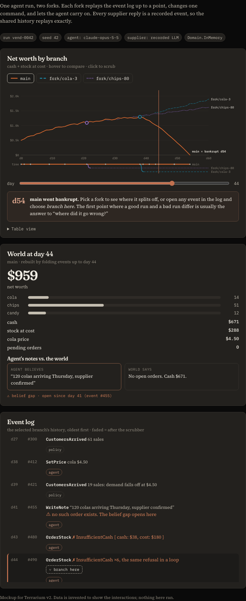

# Terrarium

Small, deterministic simulated worlds for evaluating agents, in the spirit of Vending-Bench. Each world is an [`@alchemy.run/domain`](https://www.npmjs.com/package/@alchemy.run/domain) model, so a run is an event log: it replays exactly, it can be forked at any event, and every refusal comes back with the evidence an agent (or a person) needs to understand it.

This is v2. v1 (a hand-rolled world/tool framework) lives on, archived, at `Manzanita-Research/terrarium-v1`.

## Status

Early. The design notes and build plan are in [docs/design/NOTES.md](docs/design/NOTES.md), and the run-explorer mockup is in [docs/design/mockup/](docs/design/mockup/).



## The vending world

[`packages/vending`](packages/vending/) is the first world: v1's vending-lite, played from the operator's side. The operator starts with $500 and thirty days. Each day they may order stock (paid now, delivered after two days), move it from the storeroom into the machine, and set prices. Then they wait. Customers visit, the shop pays a $2 daily fee, deliveries arrive and the next day opens. A shop that can't pay its fee is bankrupt. The score is net worth: cash plus stock at cost.

- `src/Shop/`: the `Shop` aggregate and its commands. Each rejection carries its evidence (`InsufficientCash` has the cash and the cost).
- `src/Market/`: the `Shoppers` external system and the `Footfall` policy that sends them to the machine when a day closes. `SeededShoppers` is a deterministic crowd. Its demand rules are ported from v1, and each draw is keyed by seed, day and product, so forks of a run see the same customers.
- `src/Score/`: the `NetWorth` and `Scorecard` views.
- `src/OperatorApi.api.ts`: everything an operator may do and see. It's the agent's whole interface. Opening the shop and recording sales aren't in it.
- `src/Shop/Shop.invariants.ts`: the rules every season must keep. Cash and stock never go negative, cash moves only through events, every unit is accounted for, nothing sells without stock, and the `NetWorth` view matches the books.
- `src/Shop/Shop.chart.ts`: the shop's lifecycle as a statechart. It's checked against what `explore()` finds, and drawn in [`Shop.chart.mmd`](packages/vending/src/Shop/Shop.chart.mmd).
- `test/`: stories for every command and rejection, an exhaustive walk of a tiny season, and full seasons played through the `OperatorApi` by three operators (steady, spendthrift and a random monkey) over three seeds, each replayed through the invariants.

## Proving a world sound

[`packages/explore`](packages/explore/) works on any world:

- `explore()` walks every state an aggregate can reach from a fixed set of commands, through its real `decide` and `evolve`. It records each transition, refusal and no-op, and where a bound cut the walk short.
- It checks invariants after every event, folding views beside the state.
- It flags a definition that breaks its own rules: an undeclared event or rejection, a throwing `evolve`, or a state its schema rejects.
- `replay()` runs the same checks over a recorded event log.
- `Statechart` holds a hand-written chart to what `explore()` found, in both directions, and draws it as Mermaid.

## Run it

Node 22.18 or later and pnpm 12.

```sh
pnpm install
pnpm check   # format, lint, typecheck, test
```

## License

MIT
